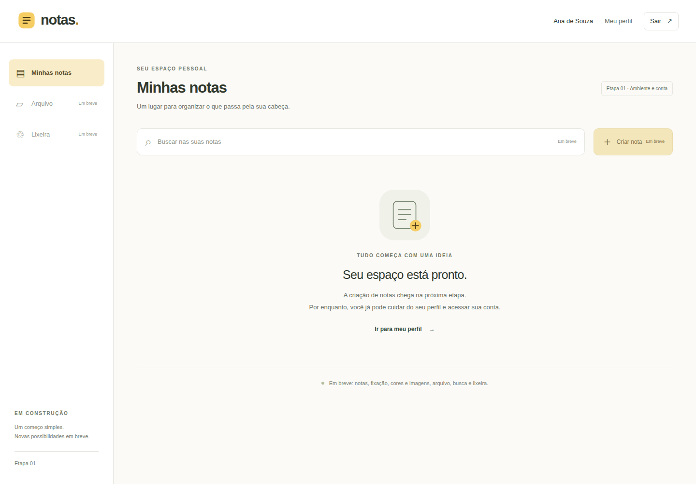

# Notas

[](https://github.com/MatheusRyuki/notas-laravel/actions/workflows/qualidade.yml)

Aplicativo de notas desenvolvido como projeto de estudo em Laravel. Organize textos e listas, compartilhe notas e continue escrevendo mesmo sem conexão.

A interface está em português, com Blade, Alpine.js e Tailwind CSS. O visual e os fundos SVG são próprios, inspirados no Google Keep.



## Funcionalidades

- Notas de texto e listas de tarefas, com edição em modal.
- Fixação, cores, fundos locais, etiquetas pessoais e ordenação.
- Busca enquanto digita, incluindo itens de listas.
- Arquivo, lixeira, restauração e exclusão definitiva com confirmação.
- Ações em lote e opção de desfazer arquivamento ou envio à lixeira por cinco minutos.
- Cópia e download das notas em texto.
- Lembretes com notificações no aplicativo e e-mail opcional.
- Compartilhamento com permissões de leitura ou edição.
- Consulta, criação e edição offline, com sincronização e resolução de conflitos.
- Cadastro, login, recuperação de senha e atualização do perfil.

## Decisões técnicas

### Concorrência na edição
Cada nota tem uma coluna `revisao` que sobe a cada alteração. Ao salvar, o cliente manda a revisão que tinha em mãos; o servidor trava a linha com `lockForUpdate` dentro de uma transação e compara. Se a revisão mudou, ninguém sobrescreve ninguém: a API responde 409 com as duas versões e a tela deixa o usuário escolher qual manter.

Escolhi isso em vez de "o último a salvar vence" porque as notas podem ser compartilhadas com permissão de edição. Com duas pessoas editando, o último salvamento apagaria o trabalho da outra sem aviso.

### Sincronização offline
Toda operação feita offline ganha um UUID no navegador. O servidor grava esse UUID junto com o resultado em `operacoes_sincronizacao`. Se a resposta se perde e o cliente reenvia a mesma operação, o servidor devolve o resultado já gravado em vez de aplicar de novo, então a nota não duplica. Na criação, o ID local vira o `uuid_sincronizacao` da nota, pelo mesmo motivo.

Na repetição eu confiro a permissão de novo. Entre a primeira tentativa e o reenvio, o dono pode ter revogado o acesso ou rebaixado a pessoa para leitura; nesse caso a resposta é `revogado_ou_excluido` ou `somente_leitura`, e a alteração não é aplicada.

### Autorização
As regras ficam na `NotaPolicy` (ver, editar, gerenciar estado, compartilhar, restaurar, excluir) e as listagens partem do escopo `acessiveisPor`, que só traz notas próprias ou compartilhadas com o usuário. O dono é sempre o usuário da sessão: a nota é criada por `$request->user()->notas()`, e `usuario_id` não está no `fillable`. Mandar outro `usuario_id` no formulário simplesmente é ignorado.

Ações em lote validam todas as notas antes de alterar qualquer uma. Se uma falhar, o lote inteiro é recusado.

### Um N+1 que corrigi
Revisando o projeto, achei que `papelDe()` fazia uma consulta por nota compartilhada: uma por cartão na listagem e duas por nota no endpoint de bootstrap do modo offline. Passei a carregar os participantes junto com as notas, filtrados pelo usuário, e o método usa a relação já carregada. O teste compara a listagem e o bootstrap com 1 e com 20 notas compartilhadas e exige o mesmo número de consultas nos dois casos, para o problema não voltar.

### Limitações conhecidas
- A edição offline de listas é feita em um campo de texto, uma linha por item. Um item só mantém o ID se continuar na mesma posição com o mesmo texto; se mudar, é recriado.
- Não há paginação: a listagem e o bootstrap carregam todas as notas acessíveis. Para o uso pessoal está ok, mas é o próximo ponto a resolver.
- Compartilhamento, lembretes, etiquetas e ações destrutivas precisam de conexão.

## Executar localmente

Você precisa de Git, Docker com Compose e internet para baixar as dependências. No Windows, use o Ubuntu no WSL2 com a integração do Docker Desktop habilitada. No Linux, use Docker Engine com Compose.

PHP, Composer e Node.js rodam em containers. Não é necessário instalá-los globalmente.

```bash
git clone https://github.com/MatheusRyuki/notas-laravel.git
cd notas-laravel
cp .env.example .env

docker run --rm \
  --user "$(id -u):$(id -g)" \
  -e COMPOSER_HOME=/tmp/composer \
  -v "$PWD":/app -w /app \
  composer:2.10 install --ignore-platform-reqs --no-scripts --no-interaction

./vendor/bin/sail up -d --build
./vendor/bin/sail composer install --no-interaction
./vendor/bin/sail composer check-platform-reqs
./vendor/bin/sail artisan key:generate
./vendor/bin/sail artisan migrate
./vendor/bin/sail npm ci
./vendor/bin/sail npm run build
```

Acesse [localhost:8004](http://localhost:8004) e crie sua conta.

O primeiro comando do Composer prepara o Sail. A instalação seguinte e a conferência dos requisitos usam o PHP 8.5 do container. Em instalações existentes, aplique novas migrations com `./vendor/bin/sail artisan migrate`, sem recriar o banco.

### Portas e serviços

| Serviço | Endereço local | Entre containers |
| --- | --- | --- |
| Aplicação | http://localhost:8004 | `laravel.test:80` |
| MySQL | `127.0.0.1:33061` | `mysql:3306` |
| Vite | http://localhost:5174 | `laravel.test:5174` |
| Mailpit | http://localhost:8026 | `mailpit:8025` |
| SMTP | Sem porta publicada | `mailpit:1025` |

Confira se as portas estão livres antes de iniciar. Os serviços são publicados apenas em `127.0.0.1`.

O projeto Compose se chama `notas`, usa a rede `notas-rede`, o volume `notas-mysql` e a imagem `notas-app:php85`. Banco e usuário MySQL se chamam `notas`. O cookie de sessão é `notas_session`.

### Comandos do dia a dia

```bash
./vendor/bin/sail up -d
./vendor/bin/sail ps
./vendor/bin/sail npm run dev
./vendor/bin/sail npm run build
./vendor/bin/sail down
```

Use `npm run dev` durante o desenvolvimento e `npm run build` para gerar os assets. Ao parar os serviços, use `down` sem `-v` para preservar os dados.

### Recuperação de senha e e-mails

Os e-mails ficam no [Mailpit local](http://localhost:8026). Para recuperar a senha, saia da conta, escolha **Esqueci minha senha** e informe o e-mail cadastrado. Abra a mensagem no Mailpit e use o link recebido. Ele expira em 60 minutos.

Os lembretes também usam o Mailpit. O envio para caixas de e-mail externas não está configurado.

## Como as notas funcionam

Regras detalhadas de cada funcionalidade estão em [docs/funcionamento.md](docs/funcionamento.md).

## Segurança

O proprietário é definido pela sessão autenticada, e as permissões são verificadas no servidor. Enviar outro `usuario_id` não permite transferir a nota ou acessar dados de outra conta.

Os formulários usam proteção CSRF, e o conteúdo das notas é exibido como texto escapado. A busca respeita os filtros de acesso e seção. Caminhos de imagem e CSS arbitrários não são aceitos.

## Testes

```bash
./vendor/bin/sail artisan test
./vendor/bin/sail bin pint --test
./vendor/bin/sail composer validate --strict
./vendor/bin/sail composer check-platform-reqs
./vendor/bin/sail npm run build
```

O PHPUnit usa SQLite em memória.

### Integração contínua

O workflow **Qualidade** executa em pushes para `main`, pull requests destinados a `main` e acionamento manual. Os jobs PHP e Frontend são independentes, em Ubuntu com PHP 8.5, Composer 2 e Node.js 24.

O job PHP executa `composer validate --strict`, `composer install`, `composer check-platform-reqs`, `php vendor/bin/pint --test` e `php vendor/bin/phpunit`. Ele também compila os assets com `npm ci` e `npm run build`, pois os testes renderizam views Blade que usam o manifest do Vite. O job Frontend verifica esses dois comandos separadamente.

O CI não usa MySQL, credenciais pessoais ou serviços locais. O cache guarda somente downloads de dependências. Testes de navegador, concorrência MySQL e implantação não fazem parte deste workflow.

## Licenças e documentação

Consulte as [licenças](docs/licencas) das ferramentas utilizadas e a [documentação do modelo de dados](docs/modelo-nota.md).
